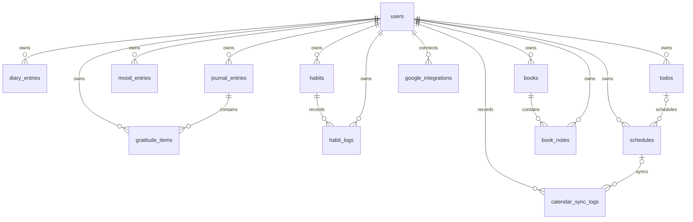

# Database design

Local development and the automated suite use SQLite. The schema uses Laravel migrations and portable foreign keys/indexes; production PostgreSQL/Supabase configuration is documented in [deployment.md](./deployment.md). A live PostgreSQL migration has not yet been run.

## Tables and relations

- `users`: Breeze credentials, verification/session fields, optional Google ID/avatar, and locale/timezone preferences.
- `diary_entries`: a user's dated diary content and insights.
- `journal_entries`: a user's dated reflection; a journal day can have multiple `gratitude_items`.
- `mood_entries`: a user's dated mood score and optional notes. A unique `(user_id, entry_date)` constraint enforces one check-in per day.
- `todos`: a user's priority/status task and optional due date.
- `habits`: a user's daily/weekly habit definition; `habit_logs` records check-ins. A unique `(habit_id, log_date)` constraint prevents duplicate daily logs.
- `schedules`: a user's start/end time, timezone, and optional `todo_id`. Deleting a task sets the relationship to null; it does not delete schedules.
- `books`: a user's reading status and page progress; `book_notes` belongs to a book and the same user.
- `google_integrations`: one provider connection per user, including encrypted access/refresh token fields, scopes, calendar ID, and status.
- `calendar_sync_logs`: per-user outcomes and non-secret error codes; deleting a schedule leaves the log with a null schedule reference.

## Integrity and time rules

- All personal records contain a `user_id`; foreign-key relationships and application validation reinforce account ownership.
- Mood and habit-log uniqueness are enforced in the database in addition to request validation.
- Schedule wall-clock input is interpreted in the selected IANA timezone, stored in UTC, and converted back for display and Google event payloads.
- Book page values are validated so the current page is non-negative and does not exceed a known total.
- Google token columns are text to accommodate encrypted payload size. `GoogleIntegration` encrypts/decrypts them through Laravel casts; `scopes` is stored as a JSON array.
- The schema intentionally does not add a denormalized completion state to schedule sessions. Task status remains on `todos`.
